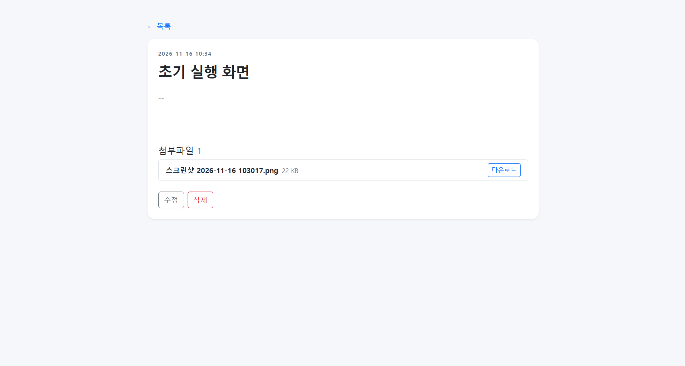
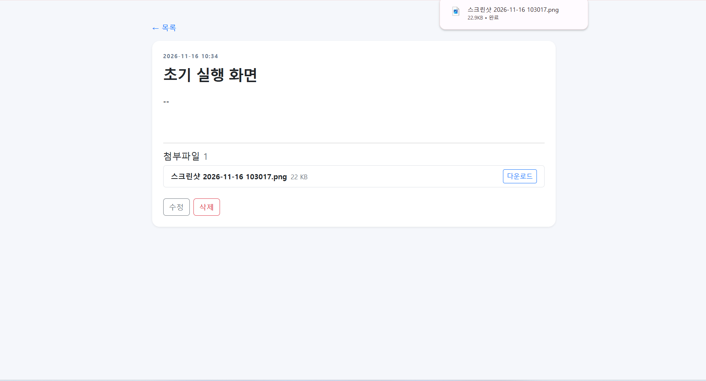
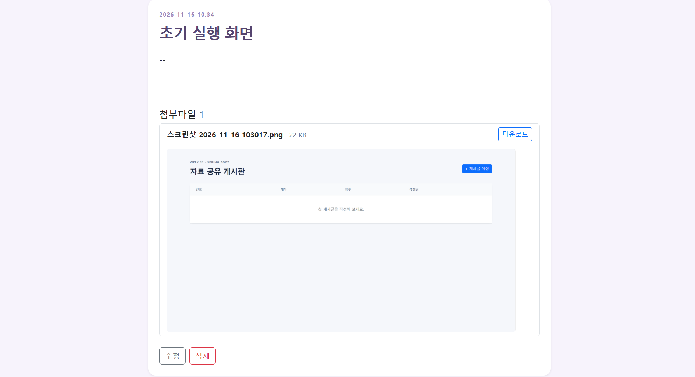

1. 프로젝트 소개 : 나의 자료실
GitHub Repository URL : 
GitHub Repository URL(개인) : https://github.com/22500323-cloud/week11_sample_project.git
Render Deployment URL : https://week11-sample-project-1-kvzu.onrender.com
2. Installation: 환경 설정 및 실행 방법

3. Source Code Exploration
Project Structure & Spring MVC
Q. PostController, PostService, PostRepository는 각각 어떤 역할을 하며, 서로 어떻게 연결되는가?
- PostController는 사용자의 요청을 받아 PostService에 전달하고 결과에 따라 화면을 보여줌
- PostService는 게시글 작성, 조회, 수정, 삭제 등의 기능을 처리하며 PostRepository를 통해 데이터베이스에 접근
각 클래스가 역할을 나누어 처리하기 때문에 코드를 관리하기 쉽다.
Q. 게시글 작성 시 HTML Form의 입력값과 첨부파일은 Controller에 어떻게 전달되는가?
- HTML Form에서 입력한 제목과 내용은 PostForm 객체에 전달
- 첨부파일은 MultipartFile 객체의 리스트로 전달
- Controller는 전달받은 데이터를 PostService의 create() 메서드에 전달
- Service에서 게시글과 파일을 처리

JPA & Entity Relationship
Q. Post와 Attachment Entity는 어떤 관계이며, @ManyToOne과 @OneToMany는 각각 어떤 역할을 하는가?
- 게시글 하나에 여러 첨부파일을 연결할 수 있다
- Post에서는 @OneToMany를 사용하여 여러 첨부파일을 관리
- Attachment에서는 @ManyToOne을 사용하여 하나의 게시글과 연결
- Attachment의 post_id가 외래키 역할
Q. cascade = CascadeType.ALL과 orphanRemoval = true는 어떤 역할을 하며, 실제 디스크에 저장된 파일에도 영향을 주는가?
- CascadeType.ALL은 게시글에 저장, 수정, 삭제 등의 작업을 할 때 연결된 첨부파일에도 해당 작업을 전파
- orphanRemoval = true는 게시글과 연결이 끊어진 첨부파일을 데이터베이스에서 삭제
- 하지만 실제 디스크에 저장된 파일까지 자동으로 삭제하지는 않기 때문에 FileStorageService의 삭제 기능을 별도로 사용해야 함
File Upload
Q. MultipartFile은 무엇이며, 업로드된 파일은 어떤 과정을 거쳐 서버에 저장되는가?
- MultipartFile은 사용자가 업로드한 파일을 Spring에서 처리할 수 있도록 제공하는 객체
- FileStorageService의 store() 메서드에서 파일의 이름, 확장자, 크기를 확인한 후 UUID를 이용해 새로운 파일명을 만들고 Files.copy()를 사용하여 서버의 업로드 폴더에 저장
Q. 파일을 원본 이름 대신 UUID 기반 파일명으로 저장하는 이유는 무엇인가?
- 여러 사용자가 같은 이름의 파일을 업로드하더라도 파일이 서로 덮어쓰이지 않도록 하기 위해서
- UUID를 사용하면 중복 가능성이 매우 낮은 파일명을 만들 수 있고 원본 파일명은 Attachment에 따로 저장하여 화면에 표시할 수 있다
File Download & Security
Q. 파일 다운로드 시 Resource, ResponseEntity, Content-Disposition은 각각 어떤 역할을 하는가?
- Resource는 서버에 저장된 파일을 나타내며 다운로드할 파일을 가져오는 데 사용
- ResponseEntity는 HTTP 응답 상태와 헤더, 파일 내용을 설정
- Content-Disposition은 브라우저가 파일을 다운로드하도록 설정
- 원본 파일명을 전달하는 역할을 한다.
Q. 파일 저장 과정에서 normalize()와 startsWith()를 사용하는 이유는 무엇인가?
- normalize()는 파일 경로에 포함된 불필요한 요소를 정리하여 경로를 정규화
- startsWith()는 정리된 경로가 지정된 업로드 폴더 내부에 있는지 확인
- 다른 폴더의 파일에 접근하려는 경로 조작을 방지할 수 있다

4. Customizing: 수정 내용 3가지 및 변경 전/후 결과
text : 자료 공유 게시판 -> 나의 자료실, 게시글 작성 버튼과 안내 문구도 변경
style : 기존 파락색 계열의 디자인 -> 라벤더로 색상 변경
UI/data : 첨부파일 개수를 일반 텍스트로 표시 -> bootstrap배시 형태로 표시

5. New Feature : 게시글 상세 페이지에서 이미지 파일을 바로 확인할 수 있도록 미리보기 기능을 추가

6. Testing & Deployment 

7. Weekly Review
새롭게 배운 내용 3가지
- MultipartFile을 이용해 사용자가 업로드한 파일을 서버에서 처리하는 방법
- UUID를 사용하면 같은 이름의 파일이 업로드되어도 충돌을 방지할 수 있다는 것
- ResponseEntity와 Resource를 이용하여 파일 다운로드와 이미지 미리보기를 구현하는 방법
어려웠던 점과 해결 방법
:이미지 미리보기 기능을 구현하는 것이 힘들었다 
처음에는 Thymeleaf에서 file 변수를 사용하는 위치가 잘못되어 500 오류가 발생했다
오류 메시지와 HTML 코드를 확인하면서 이미지 미리보기 코드를 반복문 내부로 옮기고 이후 정상적으로 이미지가 표시되는 것을 확인했다
AI 활용 내용 및 느낀 점
:AI를 활용하여 기존 소스 코드의 역할을 이해하고 파일 업로드와 다운로드 과정을 분석했다
또한 오류 메시지를 확인하고 수정할 부분을 찾는 데 도움을 받았다

